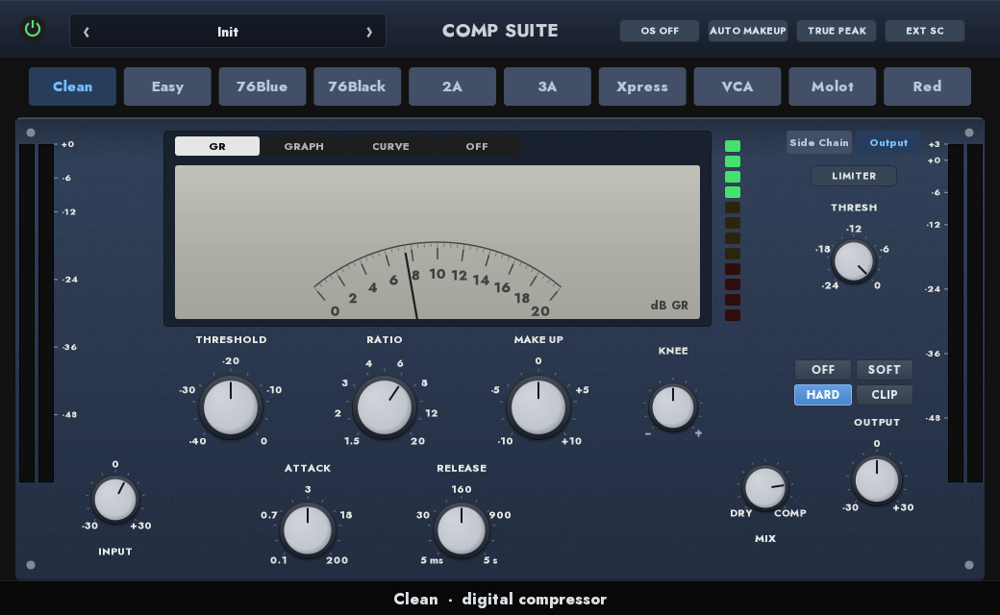
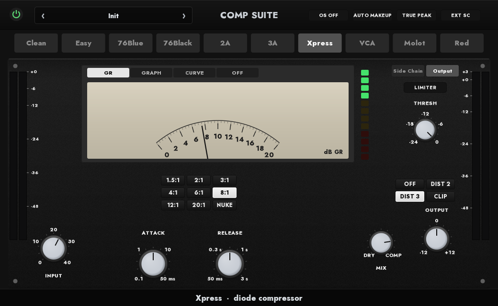

# Comp Suite

**Version 0.9.0** · GPL-3.0-or-later · [Releases](https://github.com/tylorismusic-commits/comp-suite/releases)

Ten compressor models in one CLAP and LV2 plugin for Linux. The goal is a
single plugin that covers a whole mix: transparent digital control, classic
FET / optical / VCA behaviour, and character models with saturation and stereo
tricks.


## Models

| Tab | Character | Core |
|---|---|---|
| **Clean** | Transparent digital compression | Stereo RMS detector, soft knee, transfer-curve display |
| 76Blue | 1176-family FET, blue-stripe voicing | Feedback FET limiter |
| 76Black | 1176-family FET, black-face voicing | Feedback FET limiter |
| 2A | LA-2A-family optical leveler | Photocell, side-chain network, Limit/Compress |
| 3A | LA-3A-family optical leveler | Faster photocell, fixed ratio |
| Xpress | Distressor-family compressor | Fixed threshold, ratio steps, distortion modes |
| VCA | SSL-style stereo bus compressor | Feed-forward VCA, link and auto release |
| Molot | Character compressor | Diode envelope, soft-knee transfer, saturator, six stereo modes |
| **Red** | British Class-A VCA (Focusrite Red family) | True-peak feed-forward, compression then limiting, transformer colour |
| **Easy** | Drum character compressor | Squish/Lift, drum-type voicing, Beef/Air, Soft/Tape/Hard saturation |

Every model shares one ratio ladder, so the same control position means the
same ratio when switching tabs. Clean, VCA and Molot also share the same
−40…0 dB threshold range.

## Features

- **Metering** — stereo L/R input and output meters, gain-reduction meter with
  LED column, and four display modes: gain reduction, +8/+4 VU, GR history and
  (new) a live **transfer curve** with the operating point.
- **Detection that matches the hardware** — 76 and 2A/3A detect in the feedback
  loop; the VCA and Clean are feed-forward. A bounded gain computer keeps the
  76 from nulling on transients.
- **External side-chain** on both formats, with an Internal/External switch.
- **Auto-makeup** — tracks average reduction and restores the level.
- **True-peak limiting** — optional four-times oversampled detector.
- **Molot stereo modes** — Mono, Dual Mono, Mid, Side, M/S and Stereo.
- **Preset banks** — 41 factory presets, exported as LV2 `pset:Preset` banks.
- **Ardour integration** — gain reduction in the mixer strip through the
  Harrison inline-display extension.

## Download

Each release has three assets:

| Asset | Contents |
|---|---|
| `comp-suite-<ver>-linux-x86_64.tar.gz` | both bundles |
| `comp-suite-<ver>-lv2.tar.gz` | `comp-suite.lv2/` |
| `CompSuite-<ver>-clap.tar.gz` | `CompSuite.clap` + `CompSuite.resources/` |

Install for the current user:

```sh
tar xzf comp-suite-<ver>-lv2.tar.gz  -C ~/.lv2
tar xzf CompSuite-<ver>-clap.tar.gz -C ~/.clap
```

`~/.lv2` and `~/.clap` are the per-user plugin directories most hosts scan.

## Build

Requires CMake 3.16+, a C++17 compiler, and Cairo, FreeType and X11
development packages. `lilv` and `xvfb-run` are optional but enable the LV2 and
UI tests.

```sh
cmake -S . -B build
cmake --build build -j
ctest --test-dir build --output-on-failure
```

Install:

```sh
cmake -S . -B build -DLV2_DIR="$HOME/.lv2" -DCLAP_DIR="$HOME/.clap"
cmake --build build -j
cmake --install build
```

`LV2_DIR` matters: `~/.local/lib/lv2` is not on the default LV2 search path.

A release tarball is produced by `cmake --build build --target dist`.

## Screenshots

| | |
|---|---|
|  |  |
|  |  |
|  |  |
|  | |



## Status

The plugin is usable and released. Work continues on:

- **Hearth Compressor** — a British Neve-family compressor, named after the
  Hearth channel strip. Next model.
- **Oversampling** — 2× FET gain cell with latency compensation.

Measured behaviour lives in `tools/measure.py`, which renders reference
implementations through REAPER and compares static curves, timing and
harmonics.

## Notes

- The plugin URI (`https://github.com/tylorismusic-commits/comp-suite`) is part
  of the saved-session format. Renaming the repository would break every saved
  session, so it must stay.
- Licensed GPL-3.0-or-later. The JSFX references used for character models are
  MIT; see `THIRD_PARTY_NOTICES.md`.
