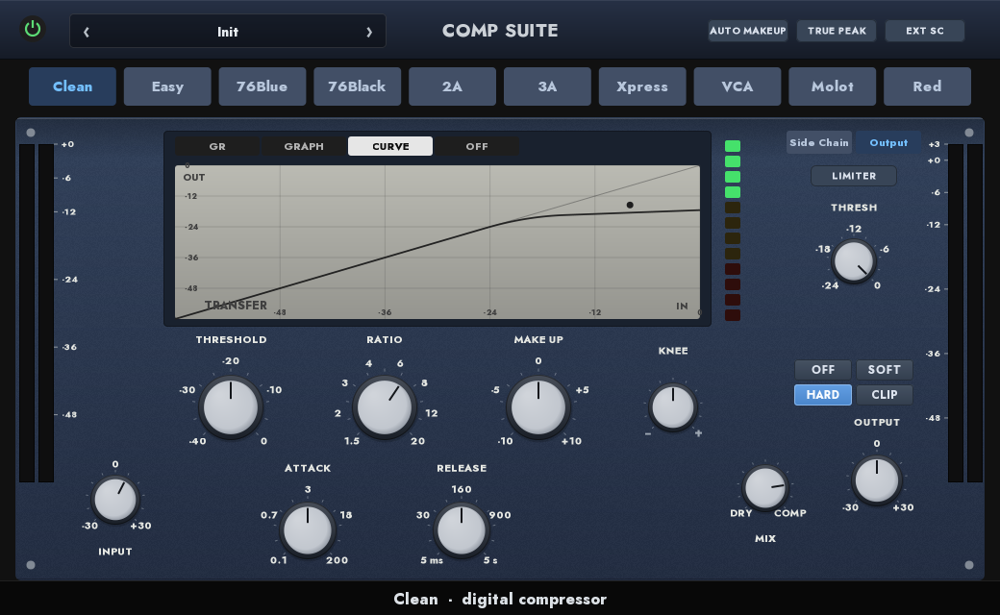
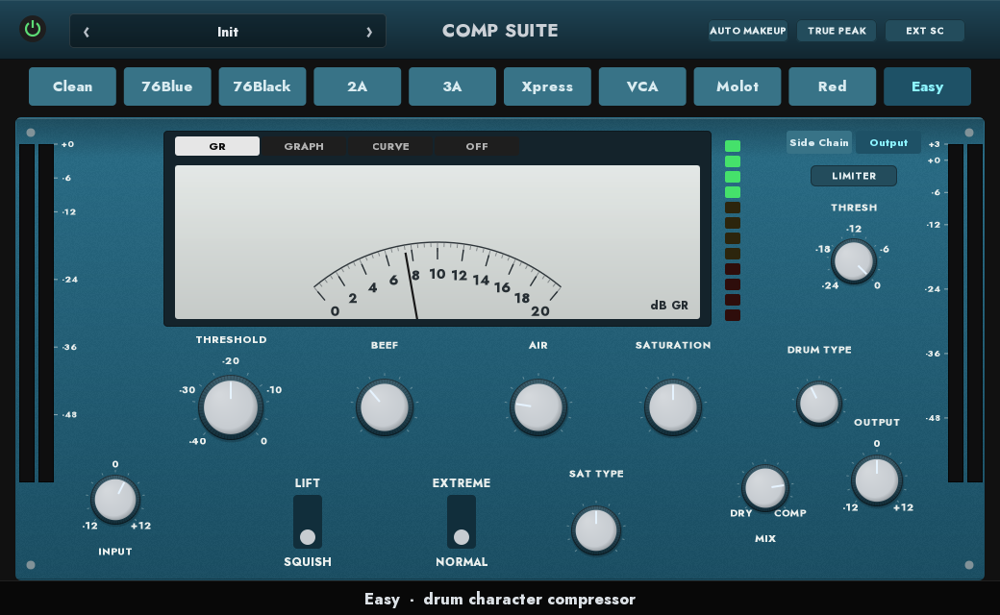
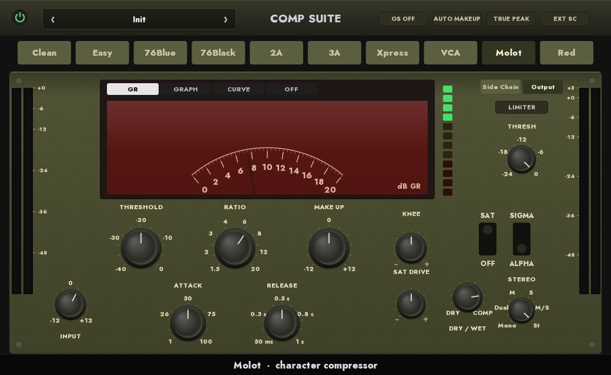
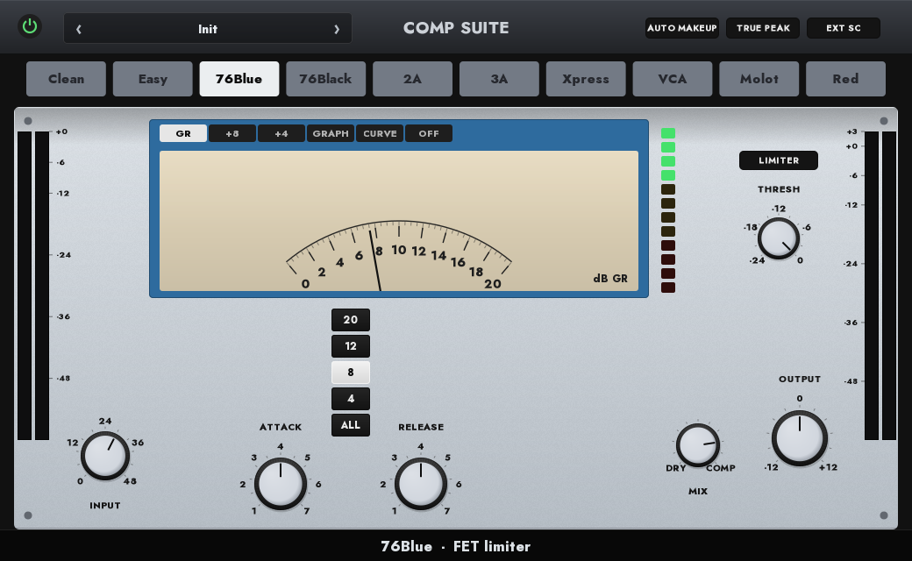
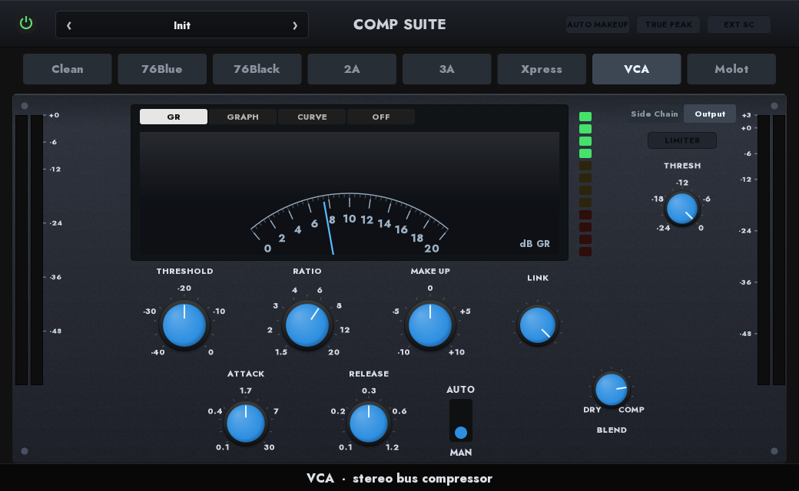
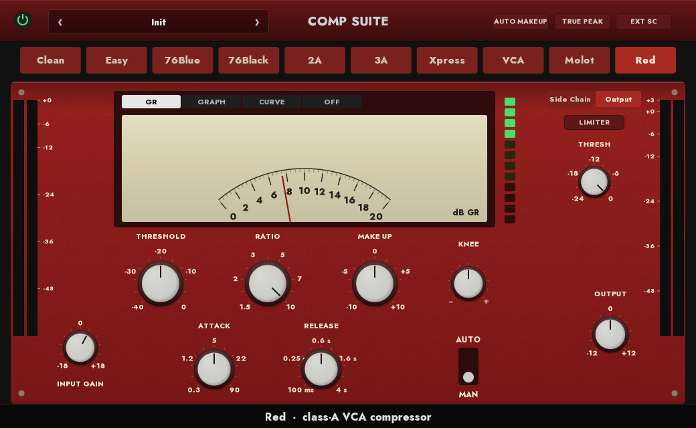

# Comp Suite

**Version 1.0.0** · GPL-3.0-or-later · [Releases](https://github.com/tylorismusic-commits/comp-suite/releases)

Ten compressor models in one CLAP and LV2 plugin for Linux. The goal is a
single plugin that covers a whole mix: transparent digital control, classic
FET / optical / VCA behaviour, and character models with saturation and stereo
tricks.



## 1.0 highlights

- **The 76s are rebuilt around the NC76 law** — feed-forward peak detection,
  a `(ratio−1)/ratio` slope, 40 µs–1.6 ms attack, full-band output, and a fixed
  calibration that puts them at the reference level. High ratios and All In
  stay musical instead of collapsing, and there is a new **MAKE UP** control
  separate from OUTPUT.
- **Oversampling: Off / 2× / 4×** across the whole path. 2× reports 30 samples
  and 4× 45; both formats pass the latency to the host for PDC. Off remains
  zero-latency.
- **All ten models are level-matched at noon** (within about 2 dB on broadband
  material), so flipping tabs changes the sound, not the monitoring level.
- **Presets refreshed** — the 76 bank was re-solved for the new law, the three
  off-bank ratios moved onto 4/8/12/20/ALL, and every model-specific switch is
  now stated explicitly so a preset cannot inherit the previous model's setup.
- **Bug fixes** — per-channel oversampling state (the right-side buzz), the
  CLAP latency/reactivation lifecycle, mix applied once on Easy/Molot, a
  transparent limiter, side-chain-aware transfer curve, non-finite input
  guards, and no parameter leakage on model switches.

## Models

| Tab | Character | Core |
|---|---|---|
| **Clean** | Transparent digital compression | Stereo RMS detector, soft knee, transfer-curve display |
| 76Blue | 1176-family FET, blue-stripe voicing | Feed-forward FET detector, transformer/FET colour |
| 76Black | 1176-family FET, black-face voicing | Feed-forward FET detector, softer knee |
| 2A | LA-2A-family optical leveler | Photocell, side-chain network, Limit/Compress |
| 3A | LA-3A-family optical leveler | Faster photocell, fixed ratio |
| Xpress | Distressor-family compressor | Fixed threshold, ratio steps, distortion modes |
| VCA | SSL-style stereo bus compressor | Feed-forward VCA, link and auto release |
| Molot | Character compressor | Diode envelope, soft-knee transfer, saturator, six stereo modes |
| **Red** | British Class-A VCA (Focusrite Red family) | True-peak feed-forward, compression then limiting, transformer colour |
| **Easy** | Drum character compressor | Squish/Lift, drum-type voicing, Beef/Air, Soft/Tape/Hard saturation |

Most models share one ratio ladder, so the same control position means the
same ratio when switching tabs. The Red uses its own six-position ladder
(1.5 / 2 / 3 / 5 / 7 / 10), and Easy's ratio follows its Squish/Lift switch.
Clean, VCA, Molot, Red and Easy share the −40…0 dB threshold range.

## Easy



Easy is the drum-focused character compressor, and the friendliest place to
start. It sits directly after Clean in the tab strip. **Squish** is fast and
aggressive; **Lift** is slower and glues. **Drum Type** re-voices the detector
and time constants for Toms, Kick, Snare, Room, overheads or Parallel. **Beef**
lifts the low end into the compressor, **Air** lifts the top after it, and
**Saturation** adds Soft, Tape or Hard colour. Normal/Extreme sets the
intensity, and link plus parallel mix behave as on the other models.

## Features

- **Metering** — stereo L/R input and output meters, gain-reduction meter with
  LED column, and five displays: gain reduction, +8/+4 VU, GR history, a live
  **transfer curve** with the operating point, and Off. When the external
  side-chain is routed, the curve follows the side-chain input and marks it
  **SC**.
- **Detection that stays musical** — the 2A/3A use their feedback cell; the 76
  uses a feed-forward peak detector and a (ratio−1)/ratio slope, the same law
  as the NC76 reference, so 8:1, 12:1, 20:1 and All In stay audible instead of
  latching the gain. VCA and Clean are feed-forward too.
- **External side-chain** on both formats, with an Internal/External switch.
- **Auto-makeup** — tracks average reduction and restores the level.
- **True-peak limiting** — optional four-times oversampled detector.
- **Oversampling** — Off, 2× or 4× across the whole signal path, Off by default.
  2× adds 30 samples of latency and 4× adds 45; both are reported to the host
  for delay compensation.
- **Molot stereo modes** — Mono, Dual Mono, Mid, Side, M/S and Stereo.
- **VCA Link** — 0% gives independent left/right detectors (dual mono); 100%
  (default) makes both detectors follow the louder channel, so a stereo bus
  does not shift when one side is louder. It changes detection only, never the
  stereo image.
- **Level-matched models** — every model is output-calibrated at noon, so
  switching tabs changes the sound, not the monitoring level. The output knob
  is a trim around that calibrated level; the 76s also have a separate make-up
  control.
- **Preset banks** — 49 factory presets, exported as LV2 `pset:Preset` banks.
- **Ardour integration** — gain reduction in the mixer strip through the
  Harrison inline-display extension.

## Download

Each release has three assets:

| Asset | Contents |
|---|---|
| `comp-suite-<ver>-linux-x86_64.tar.gz` | both bundles |
| `comp-suite-<ver>-lv2.tar.gz` | `comp-suite.lv2/` |
| `CompSuite-<ver>-clap.tar.gz` | `CompSuite.clap` + `CompSuite.resources/` |

Install for the current user:

```sh
tar xzf comp-suite-<ver>-lv2.tar.gz  -C ~/.lv2
tar xzf CompSuite-<ver>-clap.tar.gz -C ~/.clap
```

`~/.lv2` and `~/.clap` are the per-user plugin directories most hosts scan.

## Build

Requires CMake 3.16+, a C++17 compiler, and Cairo, FreeType and X11
development packages. `lilv` and `xvfb-run` are optional but enable the LV2 and
UI tests.

```sh
cmake -S . -B build
cmake --build build -j
ctest --test-dir build --output-on-failure
```

Install:

```sh
cmake -S . -B build -DLV2_DIR="$HOME/.lv2" -DCLAP_DIR="$HOME/.clap"
cmake --build build -j
cmake --install build
```

`LV2_DIR` matters: `~/.local/lib/lv2` is not on the default LV2 search path.

A release tarball is produced by `cmake --build build --target dist`.

## Screenshots

| | |
|---|---|
|  |  |
|  |  |
|  |  |
|  | |


## Status

1.0 is the finished feature set: ten models, off/2×/4× oversampling, both
plugin formats. Ten models is the set; the Hearth compressor lives in the
Hearth channel strip instead. In-plugin **user preset saving** is planned for
1.1; CLAP and LV2 hosts already save and recall the full plugin state as their
own presets.

Shared DSP (ADAA, biquads, envelopes, oversampling, dynamics) lives in the
separate `hearth-dsp` header-only library and is consumed here as a submodule.
Measured behaviour lives in `tools/measure.py`, which renders reference
implementations through REAPER and compares static curves, timing and
harmonics.

## Notes

- The plugin URI (`https://github.com/tylorismusic-commits/comp-suite`) is part
  of the saved-session format. Renaming the repository would break every saved
  session, so it must stay.
- Licensed GPL-3.0-or-later. The JSFX references used for character models are
  MIT; see `THIRD_PARTY_NOTICES.md`.
